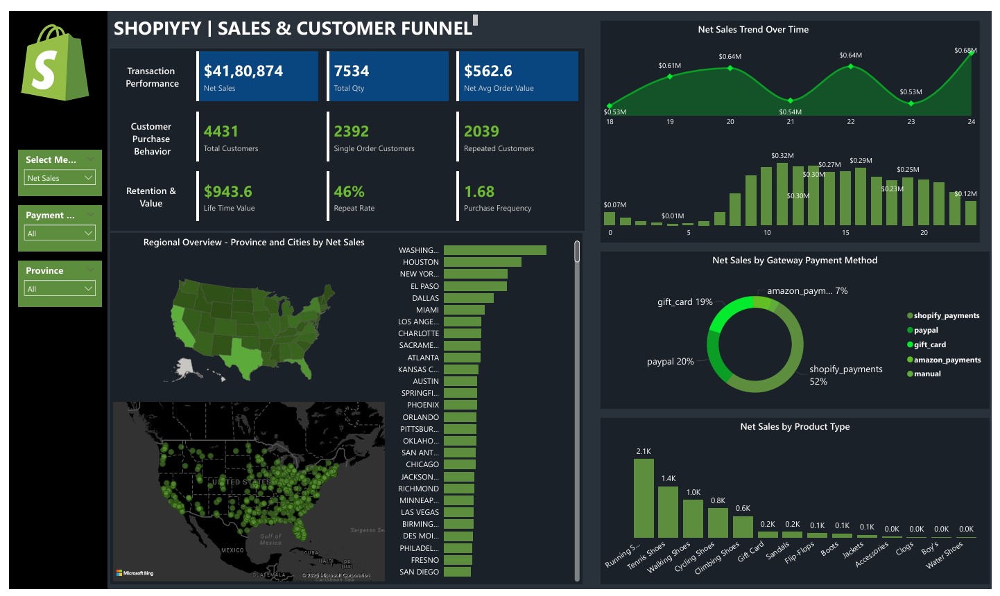
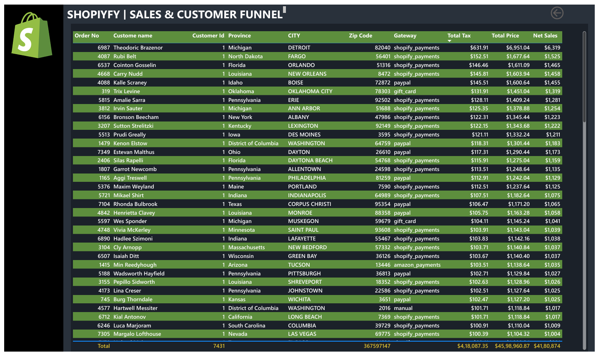

# Shopify Sales & Customer Funnel — Power BI

## Project summary

An interactive sales and customer-behavior dashboard built to explore transaction value, customer purchasing patterns, product mix, payment methods and regional performance.

**Tools:** Power BI Desktop, Power Query, DAX and interactive report features.

## Business questions

- What is the net sales value in the supplied dataset?
- How are customers split between single-order and repeat-order groups?
- Which product types and payment gateways contribute most to sales?
- Which provinces and cities lead on the selected metric?
- How do sales vary by date?
- Which customer metrics can be described reliably from the available observation period?

## Current dashboard metrics

The dashboard currently displays the following values. These are transcribed from the existing dashboard. KPI values and measures are intentionally left unchanged in this documentation pass.

| Displayed metric | Current displayed value |
|---|---:|
| Net Sales | $4,180,874 |
| Total Quantity | 7,534 |
| Net Average Order Value | $562.6 |
| Total Customers | 4,431 |
| Single-order customers | 2,392 |
| Repeat customers | 2,039 |
| Repeat rate | 46% |
| Customer Lifetime Value (dashboard label) | $943.6 |
| Purchase frequency | 1.68 |

## Analysis included

### Sales and transaction performance
- Net sales and quantity KPIs
- Daily net-sales trend
- Product-type sales comparison
- Payment-gateway sales mix

### Customer behavior
- Single-order versus repeat-customer counts
- Repeat-rate and purchase-frequency indicators
- Customer-level transaction detail

### Geography
- Province and city views
- Geographic sales distribution
- Ranked city performance

## Power BI techniques shown

The report demonstrates a combination of KPI cards, slicers, trend charts, product/payment breakdowns, geographic visuals and transaction-level detail. The exact implementation of each DAX measure, model relationship and interactive feature still needs validation against the PBIX before it is claimed as verified.

## Business interpretation and limitations

The supplied project documentation describes a one-week transaction window. When discussing repeat purchasing and the dashboard's CLV label in an interview, explain the measure definition and the observation window so that the interpretation stays aligned with what the report calculates.

## Dashboard previews

### Executive overview

### Transaction detail

## Files

- `Shofify Dashboard.pbix` — Power BI report
- `Shofify Dashboard.pdf` — exported report
- `Shopify PPT.pptx` — supporting presentation
- `Shopify - Data Terminology.docx` — terminology reference
- `d1.png`, `d2.png` — dashboard preview images

## Documentation Notes

Dashboard KPI values and measures are intentionally unchanged. Use the PBIX and terminology document to explain each metric's formula, customer/order grain and observation window when presenting the project.

## Business Questions Addressed
- What sales and order-value patterns appear in the available transaction window?
- How do single-order and repeat-customer groups compare?
- Which product types, payment gateways and locations contribute most?
- Which customer metrics can be responsibly interpreted from this dataset?

## Key Findings to Communicate
The dashboard displays $4,180,874 net sales, 7,534 quantity, $562.6 net average order value, 4,431 customers, 2,392 single-order customers, 2,039 repeat customers, 46% repeat rate, $943.6 under the dashboard's CLV label and 1.68 purchase frequency. These values are documented as the dashboard's displayed values; use the report's own definitions and current filters when discussing them. The supplied project notes a one-week transaction window, so avoid presenting the CLV label as a validated long-term lifetime forecast without explaining its formula and assumptions.

## Business Value
Commercial teams can review sales mix, payment preferences and observed repeat purchasing to guide short-window reporting and identify hypotheses for further customer analysis.

## Report / PDF
Open [the Shopify dashboard PDF](Shofify%20Dashboard.pdf), [the interactive PBIX](Shofify%20Dashboard.pbix) and [the supporting presentation](Shopify%20PPT.pptx).
